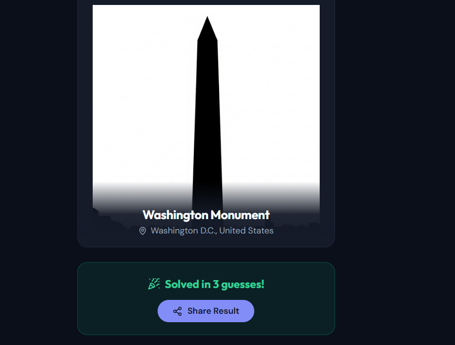

<div align="center">

# 🏛️ Silhouettele

**A daily puzzle game: guess the famous building from its silhouette in 6 tries.**

[**▶ Play now**](https://www.silhouettele.cc) · [Changelog](https://www.silhouettele.cc/changelog) · [API health](https://api.silhouettele.cc/health)

*React 19 · FastAPI (Python) · PostgreSQL · Supabase · Vercel · Railway*

</div>

<p align="center"></p>

---

## What it is

Wordle, for architecture. Every day there's one shared silhouette, and you get **6 guesses**. Each wrong guess
returns a **compass direction** toward the correct building and the **distance in kilometres**, so
you can narrow down where it is.

You can play straight away as a guest, or sign in to keep your stats, streaks, friends and leaderboard places.

**114 buildings · one puzzle a day · the same puzzle for everyone.**

## Features

| | |
|---|---|
| 🎯 **Daily puzzle** | One building per day, the same for every player, selected by date |
| 🧭 **Directional hints** | Compass arrow and distance on every wrong guess |
| 👤 **Guest mode** | Play without an account; stats are kept in `localStorage` |
| 🔐 **Accounts** | Google sign-in or email/password via Supabase Auth |
| 📊 **Stats & streaks** | Played, solved, win rate, current and longest streak |
| 🤝 **Friends** | Search, send and accept requests, friends-only leaderboard |
| 🏆 **Leaderboards** | Global and friends, ranked by streak, wins or win rate |
| 🎖️ **Achievements** | Milestone badges |
| 🗓️ **Challenges** | Weekly and monthly challenges |
| 📚 **Past puzzles** | Calendar of previous days' puzzles to play |
| 📤 **Sharing** | Wordle-style emoji results and server-rendered Open Graph share cards (spoiler-free) |
| 🌗 **Themes** | Light and dark modes, fully mobile-responsive |

## Architecture

```
                    silhouettele.cc  (Vercel · React 19)
                              │
                              │  axios → Supabase JWT  ·or·  X-Guest-ID header
                              ▼
                api.silhouettele.cc  (Railway · FastAPI)
                              │
                              │  asyncpg pool (statement_cache_size=0 for pgbouncer)
                              ▼
                          Supabase
                    ├── PostgreSQL  (RLS enabled, no client policies)
                    ├── Auth        (JWT validated server-side)
                    └── Storage     (114 silhouette images)
```

**The backend authorises every request itself.** The frontend never reads the database directly.
It only uses Supabase to sign the player in and get a token, and the backend handles all data access
over a direct Postgres connection. See [Security model](#security-model).

### Stack

| Layer | Technology |
|---|---|
| Frontend | React 19, React Router 7, Tailwind CSS, shadcn/ui, framer-motion, CRACO |
| Backend | FastAPI (Python 3.11), asyncpg |
| Database | Supabase PostgreSQL |
| Auth | Supabase Auth (Google OAuth, email/password) plus guest mode |
| Storage | Supabase Storage |
| Hosting | Vercel (frontend) · Railway (backend) |

### Repository layout

```
backend/
├── server.py          FastAPI app, /api router, CORS, /health + /health/db
├── db.py              asyncpg connection pool → Supabase Postgres
├── auth.py            get_current_user / get_user_or_guest
├── utils.py           bearing and distance maths
├── data/              building list, coordinates, silhouette URLs
├── routes/            auth · buildings · puzzle · stats · friends
│                      leaderboard · achievements · challenges · og
├── scripts/           silhouette sourcing and quality-check tools
└── tests/             pytest suite (unit + API integration)

frontend/src/
├── lib/api.js         axios client; attaches the JWT or guest ID to every request
├── contexts/          AuthContext (Supabase session), ThemeContext
├── hooks/             useDailyPuzzle (game state)
├── pages/             DailyPuzzle · Login · Profile · Leaderboard · History · Challenges · Changelog
└── components/        puzzle/ (grid, input, result, share card) · Navbar · ui/ (shadcn)
```

## Running locally

**Prerequisites:** Node 18+, Yarn, Python 3.11, a Supabase project.

```bash
# Backend
cd backend
pip install -r requirements.txt
uvicorn server:app --reload --port 8000
```

```bash
# Frontend
cd frontend
yarn install
yarn start
```

<details>
<summary><b>Environment variables</b></summary>

**Backend** (`backend/.env`)
```
SUPABASE_URL=
SUPABASE_ANON_KEY=
SUPABASE_JWT_SECRET=
SUPABASE_DB_URL=
CORS_ORIGINS=http://localhost:3000
```

**Frontend** (`frontend/.env`)
```
REACT_APP_BACKEND_URL=http://localhost:8000
REACT_APP_SUPABASE_URL=
REACT_APP_SUPABASE_ANON_KEY=
```

Never commit real values. Production secrets live in the Railway and Vercel environment settings.
</details>

## Tests

```bash
cd backend
pip install -r requirements-dev.txt   # runtime deps + pytest

# Unit tests, which need no server: bearing/distance maths and building search
pytest tests/test_directions.py tests/test_search.py

# Full suite, run against a running API
REACT_APP_BACKEND_URL=http://localhost:8000 pytest
```

The integration tests cover guest and signed-in play, hints, solving a puzzle, stats, leaderboards,
friends, achievements and challenges. The signed-in tests need `TEST_USER_EMAIL` and
`TEST_USER_PASSWORD` set, and are skipped otherwise.

## Security model

Every table has **row-level security (RLS) switched on with no policies**, and all privileges are
**revoked** from the `anon` and `authenticated` roles. With RLS on and no policy, every row is denied,
so the public key shipped in the frontend bundle gives no access to the data at all.

> ⚠️ **Do not add permissive policies** (`USING (true)`). That would expose every table to anyone
> holding the public key and bypass the backend entirely. The full rationale and a verification query
> are in [`PRD.md` §5.1](./PRD.md).

## Notable engineering decisions

- **Rhumb-line bearings, great-circle distances.** The mathematically true (great-circle) bearing
  looks wrong on a flat map: Paris → Kuala Lumpur comes out "east" when players expect "south-east."
  Directions therefore use the rhumb-line (constant compass) bearing, which matches what players expect,
  while distances stay great-circle for accuracy. This is locked in by `backend/tests/test_directions.py`.
- **Migrated MongoDB → Supabase PostgreSQL.** Friendships, leaderboards and stats are relational data,
  and the document model kept getting in the way. The application no longer has any MongoDB code.
- **Liveness and readiness are separate checks.** On 11 Oct 2026 Supabase paused the free-tier
  database after a quiet week. The game was down, but `/health` kept answering "ok" because it only
  proved the process was running. `/health` stays a plain liveness probe, so Railway's deploy
  healthcheck never fails on a database blip, and `/health/db` runs `SELECT 1` against Postgres
  for an external uptime monitor, which both raises the alarm and stops the database idling.
- **Guest-first design.** There's no signup wall: a first-time visitor plays immediately through an
  `X-Guest-ID` header, with stats kept in `localStorage`. An account is an upgrade, not a requirement.
- **Measure before monetising.** The original plan started with monetisation. I reordered it to
  instrument first, because there's no point pricing for an audience you can't measure.

## How it was built

I built Silhouettele solo. The first prototype was scaffolded with an AI app builder (Emergent). From there
I took it to production using AI coding assistants: moving the data layer from MongoDB to PostgreSQL,
splitting the frontend and API onto separate hosts, locking down the database, and fixing
correctness and security issues found in code review. I made the product, architecture and security
decisions described above.

## Author

**Ahmed Abdul-Majeed** ([@aabdul-majeed](https://github.com/aabdul-majeed) · [LinkedIn](https://www.linkedin.com/in/aabdul-majeed/)), building under the label **Loopstone Games**.

## License

© Loopstone Games. All rights reserved.
The source is public for portfolio review only. It is not licensed for reuse or redistribution.
